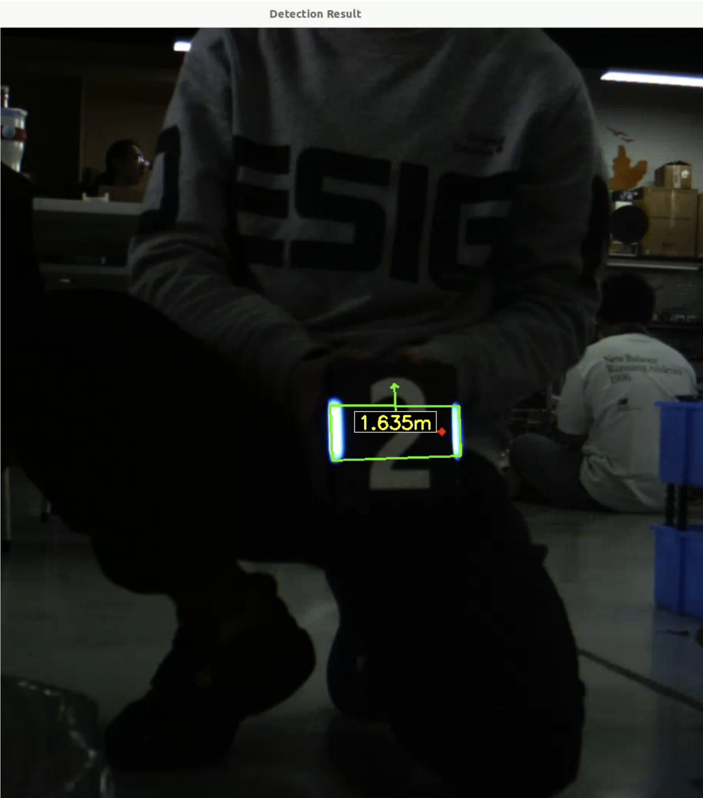
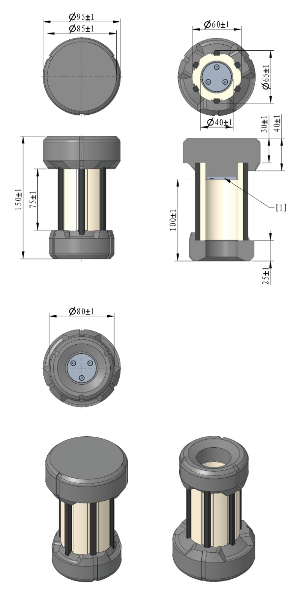
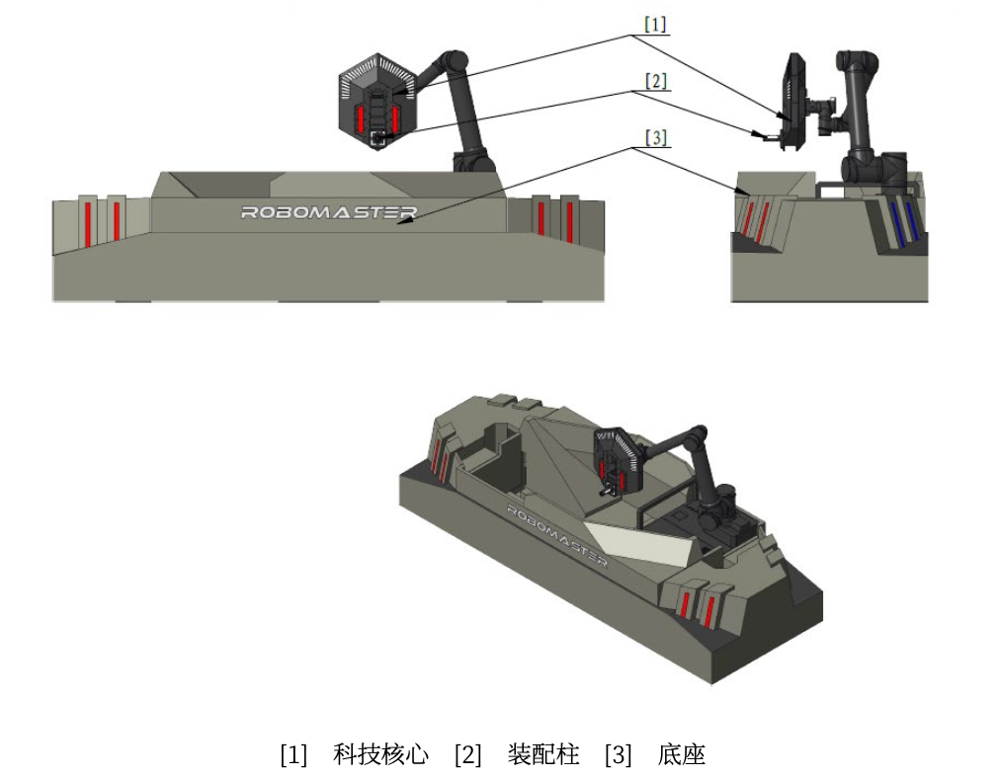
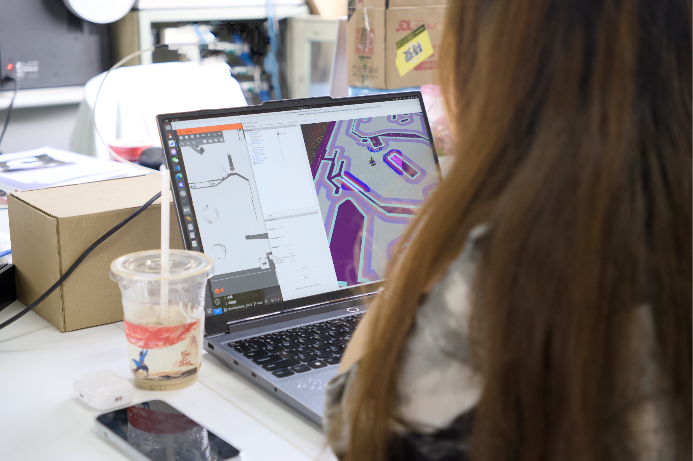
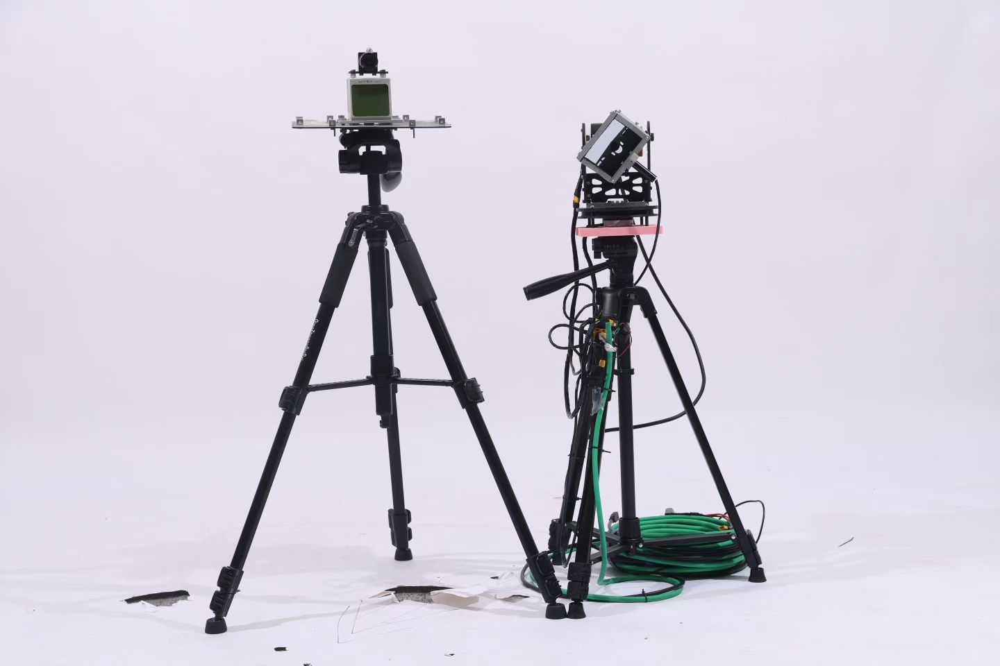

# 视觉入门

## 在开始之前

在提出你的问题之前，请确保您已经通读：[提问的智慧](https://github.com/ryanhanwu/How-To-Ask-Questions-The-Smart-Way/blob/main/README-zh_CN.md)，并且已经尝试过以下步骤：

1. 使用搜索引擎（如 Google、Bing）查找类似问题的解决方案。 
2. 查阅相关文档、手册或教程，确保您对所使用的工具和技术有基本了解。 
3. 尝试通过调试、日志分析等方法自行解决问题。

>哦不要问我为什么这个链接打不开，这你自己看着办吧。
~~都打算做视觉了一个好的梯子是你干活的时候的一个极好的加速器~~

## 崩溃提问收费表

| 合作态度 | 收费标准/说明 |
| --- | --- |
| 态度与请求他人提供帮助时应有的不符 | 不帮助解决 |
| 包含「救命啊」 |2000 CNY |
| 问题描述 < 5 字 | 500 CNY |
| 问题描述 < 10 字 | 200 CNY |
| 问题描述 < 20 字 | 50 CNY |
| 问题描述 < 20 字,有日志 | 10 CNY | 
| 问题描述 < 20 字,有截图,有日志 | 5 CNY |
| 描述详尽,截图全面,日志到位,态度适宜 | 免费,尽可能帮助解决 | 

>推荐使用 paste.ubuntu.com 粘贴内容。
推荐使用截图工具（macOS: Shift + Command + 4, Windows: Win + Shift + S, Ubuntu: PrintScreen）截图。
支付宝转账请备注「崩溃提问收费」。

## 什么是计算机视觉

计算机视觉（Computer Vision）是人工智能的一个重要领域，旨在让计算机能够理解和解释视觉信 息，如图像和视频。

## 什么是计算机

计算机（Computer）是一种能够自动执行计算任务的电子设备。它通过硬件和软件的协同工作，处理 数据并执行各种操作。

## 什么是视觉

视觉（Vision）是指通过眼睛感知光线和颜色，从而识别物体、场景和动作的能力。计算机视觉试图模 拟人类的视觉系统，使计算机能够“看见”并理解图像和视频中的内容。

## 视觉组在RoboMaster中的任务

让我们从不同的兵种来看看视觉组的任务：

1. 步兵：步兵需要识别敌方目标（如敌方机器人）的位置和状态，以便进行精准的攻击和防御。 
   - 装甲板自瞄：通过摄像头识别敌方目标，并计算其位置和距离，辅助步兵进行瞄准和射击。

   
			
      
	
      
       		
      装甲板自瞄示意图
      

   
装甲板自瞄示意图

   - 能量机关：识别场地上的能量机关位置，辅助操作手对其进行击打。 
  
2. 重装：重装需要识别和定位场地上的科技核心，以便进行相应的操作和交互。 
   - 位置识别：通过摄像头识别场地上的矿石和兑换站的位置，辅助工程进行采集和兑换操作。

   
			
      
	
      
       		
      科技核心示意图
      

   

   - 运动规划：通过物体识别和定位，规划机器人机械臂的运动路径，确保机械臂能够准确地抓取 和放置物体。

   
			
      
	
      
       		
      装配区示意图
      

   

   
			
      
	
      
       		
      工程识别兑换站示意图
      

   

   - 装甲板自瞄：同步兵
   - 基地吊射大吊射 ：辅助识别基地位置，进行远程攻击。目前的方案集中在使用里程计和IMU进行定位、雷达辅助定位和直接使用视觉进行定位。

3. <del>英雄：类似于步兵，但任务更复杂，需要处理更多的情况   </del> 牢大我们会想你的😢

4. 哨兵烧饼 ：全自动步兵的生态位

   - 全自动步兵：通过摄像头识别敌方目标，并进行自动瞄准和射击，减少对操作手的依赖。 
   - 定位与导航：通过视觉/多传感器SLAM等技术，实现机器人的自主定位和导航，提升机器人在复杂环境中的移动能力。
   - 感知：通过摄像头和其他传感器，感知自身周围的环境，识别不在前方的其他机器人和障碍物，提升机器人的环境理解能力。
   - 决策：基于感知信息，辅助机器人做出战术决策，如选择攻击目标或躲避敌人。 
   - 规划与执行：基于环境信息和任务目标，规划机器人的运动轨迹和行为策略，并执行相应的操作。

   
			
      
	
      
       		
      烧饼导航的可视化
      

   

   

3. 蜂群飞机：“空间智能” 
   - 定位与导航：通过视觉/多传感器SLAM等技术，实现无人机在复杂环境下的定位和提升飞行的稳定性。
   - 自瞄：同飞镖
   - 弹道拟合：通过弹道拟合等技术拦截飞镖、大弹丸等攻击

4. 雷达：目前唯一的全视觉兵种
   - 目标识别：通过摄像头识别敌方目标的位置和状态，辅助其他兵种进行攻击和防御。
   - 定位：通过视觉/LiDAR等技术，实现雷达对自身位置的精准定位。 
   - 传感器融合：结合视觉和雷达等多种传感器的信息，提升目标识别和定位的准确性。 
   - 决策辅助：基于识别和定位信息，辅助其他兵种做出战术决策。
   - ~~反制无人机：瞄准和照射飞机上的激光检测模块~~
   - 解析信号波：通过解调电路，解析包含队伍信息的信息波以及相近频段的干扰波
   
			
      
	
      
       		
      雷达机器人
      

   

1. 飞镖：视觉组的任务相对较少，主要集中在瞄准
   - 自瞄：识别对方基地位置，辅助飞镖进行精准投掷。

3. 网络（模型）：虽然网络的应用内嵌在各个兵种的内容里但是我为什么又要单开一个栏目呢 优秀的视觉模型是实现高效视觉任务的关键，网络的设计和训练直接影响到视觉系统的性能。
一个不会炼丹的视觉组不是一个好的视觉组

## 视觉组的技术栈

## 编程语言

C++（非常重要！！！！！）

Python

MATLAB（可选）

CUDA（可选）

## 计算机视觉库

OpenCV

PyTorch

TensorFlow（可选）（但是tensorboard很重要）

## 矩阵运算库

Eigen

## 三维处理库（可选）

PCL（点云库）

Open3D

## ROS（机器人操作系统）

ROS 2

## 操作系统

Linux (主要使用 Ubuntu)

Windows（可选）

macOS（可选）

## 硬件

摄像头（RGB、深度摄像头等）

计算单元（如 Mini PC 等）

其他传感器（IMU、激光雷达等）

## 视觉组的学习资源

在这里引用🦌的视觉“圣经”中的内容：

> # 7.6 学习路线
> ## 7.6.1 数学
> 
> 本科期间学习的 微积分、线性代数和概率论，以及离散数学（有些专业/学校会开设）是必须的。 数学是一切一切的基础。在课内学习之外，应该自行探索，着重理解关键的概念。下面的介绍大概 按照学习的顺序排列。
> 
> ## 微积分
> 
> 课程安排：分为微积分基础和多元微积分，一般在大一上和大一下分别开设。这是对工科生来 说高等数学中最核心的部分。 教材推荐：《普林斯顿微积分读本》 相对国内的定义式教材更直观，先有直观认识再加入严谨定义。 课程推荐： 麻省理工 - 微积分重点（涵盖最重要的概念，可用作预习/复习） 高等数学 - 国防科技大学（朱建民教授）——贴合应试内容，注重实用，保证考试高分，一共 有五个系列课程 先修课微积分 CAP 重要概念：映射、极限、导数和微分、泰勒公式、积分、向量值函数、多元函数、偏导数和全 微分、条件极值、多重积分、坐标变换、梯度/散>度/旋度、格林公式/高斯公式/斯托克斯公 式、傅里叶级数。
> 
> ## 线性代数
> 
> 重要性：机器学习、矩阵分析、凸优化和积分变换等后续课程的基础，被认为是计算机视觉最 核心的数理基础课。 有人说：程序员一生只要学五遍线性代数。 教材推荐： 《Linear Algebra Done Right》——抛开行列式，直击本质，从线性映射导出矩阵、特征向 量、相似等概念。 《Introduction to Linear Algebra》——结合大量工科应用实例，深入分析线性空间。 课程推荐： MIT-18.06 —— 永远的神，配合《Introduction to Linear Algebra》食用。 3Blue1Brown 的《线性代数的本质》——直观可视化，提供直觉理解。 Immersive Linear Algebra —— 可交互可视化学习网站。 后续课程：线性代数在数据分析、信号处理、机器学习中的应用。 重要概念：线性空间、列/零/行/左零空间、线性映射与变换、投影与正交矩阵、特征值/特征 向量与对角化、马尔可夫矩阵与矩阵幂、线性微>分方程组、相似矩阵、二次型、奇异值分 解。
> 
> ## 概率论
> 
> 重要性：机器学习和深度学习的根基，进阶包括随机过程、数理统计等。 教材推荐：《概率导论》《普林斯顿概率论读本》 课程推荐：MIT 概率论
> 
> 重要概念：全概率公式、贝叶斯公式、极大似然估计、最大后验估计、正态分布、中心极限定 理、大数定律、马尔科夫链。
> 
> ## 进阶（新人跳过）
> 
> MIT 18.086 《Mathematical Methods for Engineers II》 涉及方法：凸优化、复变函数、信号与系统、自动控制原理、流形分析、群论、非线性优化、 偏微分方程。
> 
> ## 7.6.2 计算机科学基础
> 
> 我们按照计算机从门电路到软件的顺序，层层抽象。
> 
> 计算机速成课：Crash Course for Computer Science 百万播放，深入浅出，短小精悍，从 ENIAC 讲到当下前沿。 模拟电路与数字电路速成 关注晶体管与逻辑门，帮助理解底层硬件。 从逻辑门开始打造一台计算机 从 0 到 1 设计一台 8 位计算机，Logisim 仿真，NandGame 网站辅助学习。 学院派的计算机科学导论 CS50 - Harvard University，课程体系完整，幽默生动，适合入门。 进阶：CSAPP《程序员的视角》、计算机组成原理、操作系统等。
> 
> ## 7.6.3 编程语言和软件框架
> 
> ## C/C++
> 
> 推荐：浙江大学翁恺教授课程。
> 
> 教材：《C++ Primer》《C++新经典》。
> 
> 工具：DevC++ 入门。
> 
> 编辑者注：DevC++ 对于入门及其的友好，但是不推荐用于实际项目开发，建议使用更现代的 IDE，如 Visual Studio Code、CLion 或者直接使用命令行工具结合 CMake 进行项目管理。
> 
> ## CMake
> 
> Linux 下管理和构建 C++ 项目的必需品。
> 
> 教程：《CMake 实践》。
> 
> ## C++ 多线程编程
> 
> C++11 标准库，推荐课程：c++11 并发与多线程视频课（建议 4 倍速）。
> 
> ## Boost / Eigen & Ceres（新人跳过）
> 
> Boost：标准库扩展。
> 
> Eigen：矩阵运算库；Ceres：非线性优化库。
>
> ## Python
> 
> 教程推荐：廖雪峰 Python 教程 、菜鸟教程 Python3。 Numpy：主要数据类型和函数接口。 Matplotlib：画图 API。
> 
> ## Matlab（新人跳过）
> 
> 工具箱多，适合 Demo 开发。
> 
> ## Shell
> 
> 学习资料：《Shell 编程快速入门》 《Shell 教程》。
> 
> ## ROS/ROS2（新人跳过）
> 
> 面向机器人开发的软件框架，提供硬件抽象、驱动管理、消息传递、模块封装。 学习 C++ 后推荐。
> 
> ## 7.6.4 数据结构和算法（新人跳过）
> 
> 推荐课程：
> 
> 浙江大学 mooc《数据结构》
> 
> 北京大学 mooc《算法设计与分析》
> 
> 学习建议：不必强行看厚书，实践中遇到再查资料。
> 
> 工具：
> 
> OI Wiki
> 
> Data Structure Visualization（算法与数据结构可视化）。
> 
> ## 7.6.5 OpenCV
> 
> 开源计算机视觉核心库。
> 
> 教材：《学习 OpenCV4》《OpenCV4 编程入门》。 学习方法： 学习某个算法后，在 OpenCV 找对应接口并实现。 重要资源：OpenCV 官方文档、CMake example。
> 
> ## 7.6.6 PyTorch
> 
> 深度学习开发标配框架，MetaAI 出品。
> 
> 官方资源：7 个视频系列，涵盖数据类型、Numpy 转换、数据集、模型、训练与推理。 学习路径： 先实现 logistic regression、多层感知机。 复现 LeNet-5 和 YOLO。 参考书：《动手学深度学习》（李沐）《深度学习》（花书）。 关键点：数据集处理脚本、DataSet/DataLoader、预处理 pipeline。
> 
> ## 7.6.7 有用的网站和资源
> 
> 官方文档：cppreference.com、cplusplus.com 学术资源：Sci-Hub、arXiv、z-lib 工具：WolframAlpha、w3school、ProcessOn、在线 LaTeX 编辑器 刷题：力扣 社区：askubuntu、opencv-soc、github issues 比赛/论文：Papers With Code、Kaggle
> 
> 其他：Google、YouTube、Wikipedia、ladder（必备）

## 迈出成为视觉组一员的第一步

## 安装Ubuntu

终于来到了最重要的一步，安装Ubuntu。推荐各位使用双系统共存的方式安装Ubuntu，既可以使用 Windows系统下的各种软件 ~~(才不是为了打游戏呢，哼)~~ ，也可以体验到Linux系统下的各种开发环境。 以下是安装Ubuntu的步骤：

1. 准备工作

   - 下载Ubuntu镜像文件（ISO格式），可以从Ubuntu官方网站下载最新版本的 Ubuntu 24.04 LTS 
   - 制作启动U盘，可以使用Rufus（Windows）或Etcher（macOS/Linux）等工具将ISO文件写入 U盘 
   - 备份数据，安装Ubuntu会格式化硬盘，确保重要数据已经备份 
   - 预分配硬盘空间：在Windows下使用磁盘管理工具缩小现有分区，为Ubuntu腾出至少20GB的 未分配空间（建议30GB或更多） 
     - 右键点击“Windows徽标” -> 选择“磁盘管理” -> 右键点击C盘（或其他分区） -> 选择“压 缩卷” -> 输入压缩空间大小（建议30000MB或更多） -> 点击“压缩” 
2. BIOS设置 
   - 重启电脑，进入BIOS设置（通常按F2、F12、Delete等键） 
   - 关闭安全启动（Secure Boot）、快速启动（Fast Boot） 
   - 设置U盘为第一启动项，保存并退出BIOS 
3. 安装Ubuntu 
   - 插入启动U盘，重启电脑，进入Ubuntu安装界面 
   - 选择“安装Ubuntu”，按照提示选择语言、键盘布局、网络连接等 
   - 选择安装类型，建议选择“其他选项”（Something else），以便手动分区 
4. 分区 
   - 选择要安装Ubuntu的硬盘，删除现有分区（注意：会删除所有数据） 
   - 创建以下分区： 
     - 根分区（/）：首次安装大小建议为20-50GB，格式为ext4 
   - 手动分区，创建根分区（/）

5. 安装过程 
   1. 选择时区，输入用户名和密码 
   2. 等待安装完成，期间可以选择安装第三方软件（如图形驱动、媒体编解码器等）
6. 完成安装
   1. 安装完成后，重启电脑，拔出U盘
   2. 进入Ubuntu系统，进行初始设置（如更新系统、安装驱动等） 
7. 安装常用软件 i
   1. 打开终端，使用apt命令安装常用软件，如Git、Vim、GCC等 
   2. 安装图形界面软件，如VSCode、PyCharm等 
8. 配置开发环境 
   1. 根据需要安装Python、C++等编程语言环境 
   2. 配置OpenCV、PyTorch等计算机视觉相关库 
9.  学习使用Ubuntu
    1. 熟悉Ubuntu的基本操作和命令行使用 
    2. 学习如何安装和管理软件包，使用终端进行开发工作 

10. 参考资源 
   - Ubuntu官方文档：https://help.ubuntu.com/ 
   - Ubuntu社区论坛：https://ubuntuforums.org/ 
   - Linux命令行教程：https://linuxcommand.org/

> ⬆️上面给出的链接都是AI生成的，但我试了一下都是可以用的。

现在你已经半只脚迈入了视觉组的大门，接下来就是不断学习和实践的过程。祝你好运！

## 迈出成为视觉组一员的第二步

## C语言--从入门到入门(WIP)

这部分大家在先修课和大一上学期都会接触到C语言的基础内容，这里就不多说了。

TBC

## 迈出成为视觉组一员的第三步

## Python--从入门到出门(WIP)

Python是一种非常适合初学者的编程语言，语法简洁，易于学习，有丰富的库和框架支持，能在简单的 代码中体验到使用第三方库的强大功能，为接下来C++调用OpenCV和其他视觉库打下基础。
在接下来的视觉组工作中，Python也会作为辅助语言使用，比如数据处理、脚本编写等。
TBC 
然后你就可以暂时的放下Python ~~（哦可能还是放不下）~~，开始学习C++了。

## 迈出成为视觉组一员的第3.5步

## 了解计算机眼中的图像

为什么是3.5步呢，因为我先写了后面的OpenCV部分，发现没有这部分的话会有点突兀。 在学习计算机视觉之前，了解图像的基本概念和表示方法是非常重要的。以下是一些关键点：

1. 图像的基本概念
   - 图像是由像素（Pixel）组成的二维矩阵，每个像素包含颜色信息。
   - 图像可以是灰度图（单通道）或彩色图（多通道，如RGB）。 
2. 图像的表示方法 
   - 数字图像：使用数字矩阵表示，每个元素对应一个像素的颜色值。 
   - 常见的图像格式：JPEG、PNG、BMP、TIFF等。 
3. 图像的分辨率 
   -  分辨率指图像的宽度和高度，以像素为单位。 
   -  分辨率越高，图像越清晰，但文件大小也越大。 
4. 颜色空间 
   - RGB颜色空间：由红、绿、蓝三种颜色通道组成。
   -  HSV颜色空间：由色调（Hue）、饱和度（Saturation）、明度（Value）组成，更符合人类视觉感知。 
   -  其他颜色空间：CMYK、Lab等。 
5. 图像处理的基本操作
   - 图像的读取和显示 
   - 图像的裁剪、缩放和旋转 
   - 图像的滤波和增强（如模糊、锐化、对比度调整等） 
   - 图像的二值化和阈值处理 
6. 图像的噪声和去噪 
   - 常见的噪声类型：高斯噪声、椒盐噪声等 
   - 去噪方法：均值滤波、中值滤波等 
7. 图像的几何变换 
   - 平移、旋转、缩放等基本变换 
   - 仿射变换和透视变换 
8. 图像的直方图 
   - 直方图表示图像中各灰度级的像素数量分布 
   - 直方图均衡化用于增强图像对比度 
  
掌握这些基本概念和操作，将为后续的计算机视觉学习打下坚实的基础。

## 那么现在可能有人要问了：计算机的图像是如何获取的呢？

计算机获取图像主要通过以下几种方式：

1. 摄像头（Camera）
摄像头是最常见的图像获取设备，通过光学镜头将光线聚焦到图像传感器上，捕捉环境中的图 像。 摄像头可以是单目摄像头（单个镜头）或双目摄像头（两个镜头，用于深度感知）。 
2. 图像生成器（Image Generators） 图像生成器可以通过计算机图形学技术生成虚拟图像，如3D渲染、游戏引擎等。 这些图像通常用于模拟环境或进行视觉算法的测试。

关于这部分老队长在上半年写过一篇培训的文章，有兴趣的可以看看：[相机和计算机图像处理-Github](https://github.com/lanlanlllma/s26_tutorial/blob/main/camera/camera_and_colib.md)

## 迈出成为视觉组一员的第四步

## OpenCV--从入门到入神(WIP)

OpenCV是一个开源的计算机视觉库，提供了丰富的图像处理和计算机视觉算法。掌握OpenCV可以帮 助你快速实现各种视觉任务。 
在视觉组的工作中，OpenCV是一个非常重要的工具，几乎所有的视觉任务都离不开它。
对于OpenCV的学习，你可以从python版本开始，熟悉基本的图像处理操作，然后逐步深入到C++版 本，了解更多高级功能和优化技巧。

> 小插曲
还记得在笔者参与的 Phoenix 面试中，老队长陈浩宇问我：“你知道OpenCV的Mat是什么吗？” 当时我愣了一下，回答道：“不知道。” 后来我才反应过来，nmd，python版本的OpenCV中没有Mat这个概念，Mat是C++版本中的一个重 要数据结构，代表图像矩阵。

TBC

## 迈出成为视觉组一员的第五步

## C++--从入门到入土(WIP)

TBC
